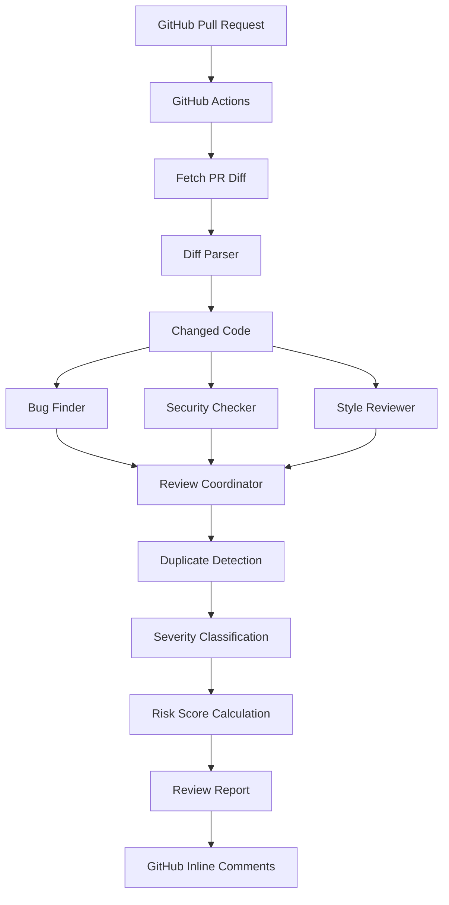

# AI-Powered Pull Request Review Bot

An AI-powered code review system that automatically analyzes GitHub Pull Requests, identifies potential bugs and security vulnerabilities, detects code quality issues, and posts actionable inline review comments.

## Project Overview

The AI Pull Request Review Bot automates the initial code review process using three specialized AI agents.

Whenever a developer opens or updates a Pull Request, GitHub Actions automatically triggers the review pipeline. The system analyzes the changed code, identifies potential issues, combines findings, calculates a risk score, and posts review comments directly on GitHub.

## Key Features

- **Automated PR Review:** Reviews code whenever a Pull Request is opened or updated.
- **Bug Detection:** Identifies potential runtime errors, including division by zero.
- **Security Analysis:** Detects vulnerabilities such as SQL injection.
- **Code Quality Review:** Identifies unnecessary variables and maintainability issues.
- **Multi-Agent Architecture:** Uses three specialized AI agents.
- **Duplicate Detection:** Combines similar findings from different agents.
- **Severity Classification:** Classifies issues as CRITICAL, HIGH, MEDIUM, or LOW.
- **Risk Scoring:** Calculates an overall PR risk score.
- **Inline GitHub Comments:** Posts findings directly on the affected code lines.
- **Automated Testing:** Runs unit tests before completing the review workflow.

## System Architecture

The project uses the following workflow:

1. Developer creates or updates a GitHub Pull Request.
2. GitHub Actions triggers the automated review pipeline.
3. The GitHub API fetches the Pull Request diff.
4. The Diff Parser extracts changed files, added code and line numbers.
5. Three specialized agents analyze the changed code:
   - Bug Finder
   - Security Checker
   - Style Reviewer
6. Review Coordinator merges duplicate findings and calculates risk.
7. GitHub Review module posts inline comments and a summary.

## Architecture Diagram



## AI Agents

| Agent | Responsibility |
|---|---|
| Bug Finder | Detects potential programming and runtime errors |
| Security Checker | Identifies security vulnerabilities |
| Style Reviewer | Checks readability and maintainability |
| Review Coordinator | Combines findings and calculates overall risk |

## Risk Scoring

The Review Coordinator calculates a risk score using severity weights and finding confidence.

| Severity | Weight |
|---|---:|
| CRITICAL | 40 |
| HIGH | 25 |
| MEDIUM | 12 |
| LOW | 4 |

Risk score formula:

`Risk Score = Sum of (Severity Weight × Finding Confidence)`

The final score is capped at 100.

The risk level is based on the highest severity detected. This is a rule-based review indicator, not a statistical probability of failure.

## Technology Stack

- **Programming Language:** Python 3.11
- **AI Model:** Groq API – GPT-OSS 120B
- **AI Integration:** Groq Python SDK
- **GitHub Integration:** GitHub REST API, PyGithub
- **Automation:** GitHub Actions
- **Data Processing:** Python JSON
- **Configuration:** Python dotenv
- **Testing:** Pytest

## Project Structure

```text
PR-Review-Bot/
│
├── .github/
│   └── workflows/
│       └── pr_review.yml
│
├── src/
│   ├── agents/
│   │   ├── bug_finder.py
│   │   ├── security_checker.py
│   │   └── style_reviewer.py
│   │
│   ├── github/
│   │   ├── fetch_diff.py
│   │   └── post_review.py
│   │
│   └── review/
│       ├── diff_parser.py
│       └── review_coordinator.py
│
├── tests/
│   └── test_review_coordinator.py
│
├── artifacts/
├── .env
├── .gitignore
├── requirements.txt
└── README.md
```

## Installation and Setup

### 1. Clone the repository

```bash
git clone https://github.com/Kavya0311/pr-review-bot-demo.git
cd pr-review-bot-demo
```

### 2. Create a virtual environment

```bash
python -m venv venv
```

Activate it on Windows:

```powershell
venv\Scripts\Activate.ps1
```

### 3. Install dependencies

```bash
pip install -r requirements.txt
```

### 4. Configure environment variables

Create a `.env` file in the project root:

```env
GITHUB_TOKEN=your_github_token
GROQ_API_KEY=your_groq_api_key
GROQ_MODEL=openai/gpt-oss-120b
```

Never commit API keys or tokens to GitHub.

### 5. Configure GitHub Actions secrets

Add the following repository secret:

`GROQ_API_KEY`

GitHub Actions provides the `GITHUB_TOKEN` automatically through its workflow environment.

Ensure the workflow has permission to write Pull Request reviews.

## Running the Project Locally

Fetch the Pull Request diff:

```bash
python src/github/fetch_diff.py Kavya0311 pr-review-bot-demo 1
```

Parse the changed code:

```bash
python src/review/diff_parser.py 1
```

Run the three AI agents:

```bash
python src/agents/bug_finder.py 1
python src/agents/security_checker.py 1
python src/agents/style_reviewer.py 1
```

Combine the findings:

```bash
python src/review/review_coordinator.py 1
```

Preview the GitHub review:

```bash
python src/github/post_review.py Kavya0311 pr-review-bot-demo 1
```

Post the review:

```bash
python src/github/post_review.py Kavya0311 pr-review-bot-demo 1 --post
```

## Running Tests

```bash
python -m pytest tests/ -v
```

The current test suite contains six tests covering:

- SQL injection finding normalization
- Division-by-zero finding normalization
- Duplicate finding merging
- Multiple issues on the same line
- Risk score calculation
- Empty findings handling

## Sample Review Result

A test Pull Request containing intentional code issues produced the following results:

| Finding | Severity | Line |
|---|---|---:|
| SQL Injection | HIGH | 3 |
| Division by Zero | MEDIUM | 9 |
| Unnecessary Temporary Variable | LOW | 13 |

**Risk Score:** 40/100

**Risk Level:** HIGH

The bot successfully posted all three findings as inline comments on GitHub.

## Future Enhancements

- Support for additional programming languages.
- Configurable review rules.
- Improved false-positive detection.
- Pull Request review history and analytics.
- More advanced security vulnerability detection.
- Customizable severity and risk thresholds.

## Important Note

AI-generated findings are suggestions and should be verified by a developer before merging. The risk score is an automated prioritization aid, not a guarantee that code is safe or unsafe.

## Author

Developed as an AI-powered software engineering project using Python, Groq and GitHub Actions.
